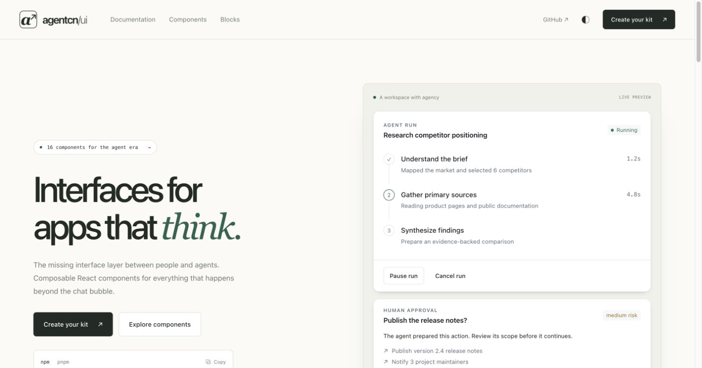

# This is Álvaro

<!-- Last updated: 2026-10-22 -->

**I build AI products and the tools to understand, test, and control them.**

I'm the founder of **[Clous](https://www.clousai.com/)**, an AI platform for
people teams, and an **AI QA architect at Iberia Airlines**.

[Tools](#start-here) · [Apps](#apps) · [All projects](projects.md) · [Website](https://alvarovillalba.com/) · [LinkedIn](https://www.linkedin.com/in/alvarovillalbaperez/)

## Start here

| What you want to do | Start with |
| --- | --- |
| **Build agent interfaces** | **[agentcn-ui](https://github.com/alvarovillalbaa/agentcn-ui)** — React components for runs, tool calls, approvals, memory, and evaluation. [Explore the demos](https://agentcn-ui.vercel.app/). |
| **Evaluate AI changes before release** | **[open-evals](https://github.com/alvarovillalbaa/open-evals)** — Reproducible evaluations, system-prompt optimization, and release gates. [Run it locally](https://github.com/alvarovillalbaa/open-evals/blob/main/README.md#quick-start). |
| **Make agent context portable** | **[AFS](https://github.com/alvarovillalbaa/afs)** — A filesystem specification for context, durable knowledge, and source provenance. [Read the specification](https://github.com/alvarovillalbaa/afs/blob/main/README.md#standard). |
| **Give agents reusable workflows** | **[Agent Company / plugins](https://github.com/alvarovillalbaa/plugins)** — Skills, commands, rules, and agents across engineering, product, and business operations. [Install workflows](https://github.com/alvarovillalbaa/plugins/blob/main/references/docs/INSTALLATION.md). |

<!-- Screenshot source: https://github.com/alvarovillalbaa/agentcn-ui/blob/main/docs/results/2026/10-15/homepage.jpg -->

*An agentcn-ui demo run with pause/cancel controls and a human approval request.*

## Apps

| Project | What you can do |
| --- | --- |
| **[Sift](https://github.com/alvarovillalbaa/sift-analytics)** · [Open app](https://sift-analytics.vercel.app/) | Explore local files with DuckDB, inspect SQL, and arrange dashboard views. |
| **[trippin](https://github.com/alvarovillalbaa/trippin)** · [Open app](https://trippin-theta.vercel.app/) | Plan trips with itineraries, maps, reservations, budgets, and expenses. |
| **[Still](https://github.com/alvarovillalbaa/still-markdown)** · [Open app](https://still-markdown.vercel.app/) | Edit Markdown in rich-text or source mode, with pages saved on your device. |
| **[Parola](https://github.com/alvarovillalbaa/parola)** · [Open app](https://parola-eta.vercel.app/) | Practice vocabulary and grammar offline with active recall and spaced review. |

Sift and trippin require configuration for AI and external data/provider connections.

## More to explore

- **[Sonant](https://github.com/alvarovillalbaa/sonant)** — Sound feedback for React and the web, with editable recipes and playback controls. [Playground](https://sonant-beta.vercel.app/).
- **[Search Gateway](https://github.com/alvarovillalbaa/search-gateway)** — One API for multi-provider AI search and source retrieval, with TypeScript/Python SDKs and MCP tools.
- **[OCR Gateway](https://github.com/alvarovillalbaa/ocr-gateway)** — Self-hosted document parsing across OCR, vision, and local providers, with citations and embedding-ready chunks.

**[Browse the full project index](projects.md)** for creative tools, research,
earlier work, team projects, and attributed upstream forks.

## A little background

I started in aerospace engineering, taught myself to program, and moved into
software and AI systems full-time. I also work on **Sentyl**, an AI
transformation agency.

Beyond AI, I've built websites for two Madrid communities:
**[Happy Run](https://github.com/alvarovillalbaa/happy-run)**, a social running club
([site](https://happy-run-six.vercel.app/)), and
**[teki](https://github.com/alvarovillalbaa/teki)**, a technology community
([site](https://teki-chi.vercel.app/)).

My core stack is **Python, TypeScript, React/Next.js, Django, and PostgreSQL**.

If you're building agent infrastructure, evaluation tools, or AI products,
[let's talk](https://www.linkedin.com/in/alvarovillalbaperez/).
