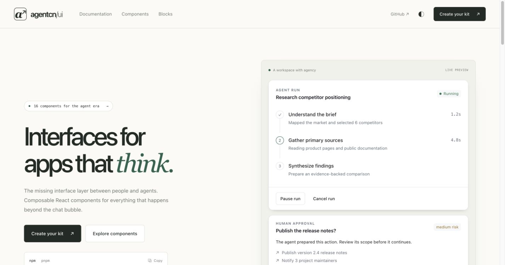

# Álvaro Villalba

**I build AI products and the tools to understand, test, and control them.**

I'm the founder of [Clous](https://www.clousai.com/), an AI platform for people teams, and an AI QA architect at Iberia Airlines. I also work on Sentyl, an AI transformation agency.

I came to software through aerospace engineering. Here you'll find agent infrastructure, model experiments, small apps I wanted to use, and a couple of games I wanted to play.

[Website](https://alvarovillalba.com/) · [LinkedIn](https://www.linkedin.com/in/alvarovillalbaperez/) · [Public projects](#projects)

## Start here

- **Build the interface for an agent.** [agentcn/ui](https://github.com/alvarovillalbaa/agentcn-ui) provides React components for runs, approvals, tool calls, and artifacts. [Explore the demos](https://agentcn-ui.vercel.app/).
- **Test what an agent actually did.** [Open Evals](https://github.com/alvarovillalbaa/open-evals) supports reproducible checks, prompt improvement, and release gates. [HRBench Ops](https://hr-bench.vercel.app) lets you inspect synthetic HR tasks scored by their sandbox's final state.
- **Carry context and workflows across agent tools.** [AFS](https://github.com/alvarovillalbaa/afs) specifies how to store that context on disk. [Agent Company](https://github.com/alvarovillalbaa/plugins) supplies reusable workflows and a cross-runtime installer.
- **Try something different.** [Framelet](https://github.com/alvarovillalbaa/framelet/releases/tag/v0.1.5-preview.1) records and edits clips locally on the Mac. In [Driftwing](https://driftwing-alvaro.vercel.app), you fly a little plane through wind currents in your browser.

*An agent run you can pause, cancel, or intervene in. Click to try the interface.*

## Projects

[Agent infrastructure](#agent-infrastructure) · [UI libraries](#ui-libraries) · [Developer tools](#developer-tools-and-extensions) · [OS apps](#os-apps) · [Web apps](#web-and-creative-apps) · [Games](#games) · [AI research](#ai-research-and-evaluation) · [AI Lab](#ai-research-lab) · [Engineering research](#engineering-research) · [Knowledge](#knowledge-and-notes) · [Community](#community-and-earlier-work) · [Clous](#clous) · [Forks](#upstream-forks)

The tables cover my public GitHub repositories and Clous's public repositories. Expand a section for source, demos, downloads, or research notes.

Project READMEs use a **Project family** label and an **Area** to connect related repositories. These labels describe how the work is grouped; each project documents its own implementation and release status.

### Agent infrastructure

Tools for giving agents context, composing reusable workflows, and connecting them to external services.

Libraries, gateways, and workflow packages

| Project | What it does |
| --- | --- |
| [AFS](https://github.com/alvarovillalbaa/afs) | A filesystem standard for portable agent instructions, knowledge, work history, and source provenance. [Specification](https://github.com/alvarovillalbaa/afs/blob/main/skills/use-afs/references/afs-standard.md) |
| [Agent Company](https://github.com/alvarovillalbaa/plugins) | Reusable agent skills and workflows for engineering, product, and business operations, with a cross-runtime installer. |
| [Search Gateway](https://github.com/alvarovillalbaa/search-gateway) | Self-hosted multi-provider search and source retrieval for apps and agents. [SDK releases](https://github.com/alvarovillalbaa/search-gateway/releases) |
| [OCR Gateway](https://github.com/alvarovillalbaa/ocr-gateway) | Self-hosted document parsing across OCR, vision, and local providers, with citations and embedding-ready chunks. [SDK releases](https://github.com/alvarovillalbaa/ocr-gateway/releases) |
| [AI App Jumpstart](https://github.com/alvarovillalbaa/ai-app-jumpstart) | A Next.js and Eve starter that shares application records across a web UI, REST, CLI, and MCP. In development. |
| [vAFS](https://github.com/alvarovillalbaa/vafs) | A local AFS reader and read-only MCP entry point, alongside an earlier virtual filesystem prototype. |
| [Agent Library](https://github.com/alvarovillalbaa/agent-library) | A catalogue of agent skills, MCP servers, subagents, and commands for business work. Archived. |
| [Business Claw](https://github.com/alvarovillalbaa/business-claw) | A control-plane prototype for separate OpenClaw workspaces per customer organization. Archived. |

### UI libraries

Reusable components and interaction layers for applications: agent interfaces, MCP Apps, and interface sounds.

| Project | What it does |
| --- | --- |
| [agentcn/ui](https://github.com/alvarovillalbaa/agentcn-ui) | React components for agent runs, tool calls, approvals, memory, artifacts, and evaluation. [Docs and demos](https://agentcn-ui.vercel.app/) |
| [MCPCN](https://github.com/alvarovillalbaa/mcpcn-ui) | React components, workflow blocks, and runtime helpers for human-controlled MCP Apps. [Docs and installs](https://mcpcn-ui.vercel.app/docs#install) |
| [Sonant](https://github.com/alvarovillalbaa/sonant) | Composable interface sounds and playback controls for React and the web. [Playground](https://sonant-beta.vercel.app/) |

### Developer tools and extensions

Tools that fit into a code editor, browser, test suite, or publishing workflow.

Libraries, extensions, and test tools

| Project | What it does |
| --- | --- |
| [Traverse](https://github.com/alvarovillalbaa/traverse) | Run Playwright browser journeys from Vitest with exact assertions and optional agent steps. [Preview package](https://github.com/alvarovillalbaa/traverse/releases) |
| [Contextlet](https://github.com/alvarovillalbaa/contextlet) | A VS Code extension that turns selected code and diagnostics into a Markdown handoff you can review. [Developer preview](https://github.com/alvarovillalbaa/contextlet/releases) |
| [Tracelet](https://github.com/alvarovillalbaa/tracelet) | A Chrome extension for recording a tab, editing the resulting checklist, and replaying approved steps. [Get the extension](https://tracelet-three.vercel.app) |
| [Intakelet](https://github.com/alvarovillalbaa/intakelet) | An onboarding SDK that turns customer files and public websites into reviewed records and source-backed knowledge. [Playground](https://intakelet.vercel.app) |
| [Clero](https://github.com/alvarovillalbaa/clero) | A Markdown documentation publisher with a local editing workspace, reader, and static-site CLI. |

### OS apps

I build small native tools for jobs I do often, from finding documents to recording a walkthrough.

macOS, iOS, visionOS, and watch projects

| Project | What it does |
| --- | --- |
| [Framelet](https://github.com/alvarovillalbaa/framelet) | Native macOS screen recording, clip editing, and MP4 export. [Developer preview](https://github.com/alvarovillalbaa/framelet/releases/tag/v0.1.5-preview.1) |
| [Findlet](https://github.com/alvarovillalbaa/findlet) | A macOS menu-bar search utility for selected local text and Markdown folders, powered by QMD. [Developer preview](https://github.com/alvarovillalbaa/findlet/releases/tag/v0.1.1-preview.1) |
| [Roomlet](https://github.com/alvarovillalbaa/roomlet) | A native macOS utility for reviewing large files and reclaiming disk space. [Developer preview](https://github.com/alvarovillalbaa/roomlet/releases/tag/v0.1.1-preview.1) |
| [Conductor](https://github.com/alvarovillalbaa/conductor) | A native iOS prototype that works backward from a shared finish time to schedule when tasks should start. |
| [Spatial Whiteboard](https://github.com/alvarovillalbaa/spatial-whiteboard) | A native visionOS prototype for drawing and editing diagrams in a spatial window. |
| [Watch Agents](https://github.com/alvarovillalbaa/smart-watch-agents) | A self-hosted control hub for Hermes and OpenClaw runs, with macOS, watchOS, and Wear OS companion source. [Web preview](https://watch-agents-alvaro.vercel.app) |

### Web and creative apps

Workspaces for things I do away from the terminal, including planning trips, learning languages, and making visual work.

Everyday apps

| Project | What it does |
| --- | --- |
| [trippin](https://github.com/alvarovillalbaa/trippin) | Trip planning with itineraries, maps, reservations, budgets, and expenses. [Web app](https://trippin-theta.vercel.app/) |
| [Sift](https://github.com/alvarovillalbaa/sift-analytics) | Explore local files with DuckDB, inspect generated SQL, and arrange dashboard views. [Web app](https://sift-analytics.vercel.app/) |
| [Still](https://github.com/alvarovillalbaa/still-markdown) | Write in rich-text or Markdown source mode, with device-local editing. [Web app](https://still-markdown.vercel.app/) |
| [Parola](https://github.com/alvarovillalbaa/parola) | Practice vocabulary and grammar with active recall, spaced review, and offline progress. [Web app](https://parola-eta.vercel.app/) |
| [Minuta](https://github.com/alvarovillalbaa/minuta) | A Spanish-first meeting notebook with on-device transcription and source-quoted notes you can review. [Web app](https://minuta-liard.vercel.app) |
| [Ayudario](https://github.com/alvarovillalbaa/ayudario) | Find Spanish public aid through official sources and build a private preparation checklist. [Web app](https://ayudario-xi.vercel.app) |
| [Kickoff](https://github.com/alvarovillalbaa/kickoff) | A Spanish-language app for finding football games, organizing players, and booking pitches. [Preview](https://kickoff-football-seven.vercel.app/) |
| [Dearweek](https://github.com/alvarovillalbaa/dearweek) | A family memory app with per-story audiences for iOS, Android, and web. Archived. |

Creative, publishing, and product tools

| Project | What it does |
| --- | --- |
| [Pliego](https://github.com/alvarovillalbaa/pliego) | Design generative posters, preview them at room scale, and explore lamp forms. [Web app](https://pliego-zeta.vercel.app) |
| [Inspiration Canvas](https://github.com/alvarovillalbaa/inspiration-canvas) | Collect, arrange, and annotate visual references on a local-first infinite canvas. [Web app](https://inspiration-canvas.vercel.app) |
| [Linen](https://github.com/alvarovillalbaa/linen) | Build a portable personal site from links, projects, notes, and media. Source available, with hosting pending. |
| [Intelligent Visualization](https://github.com/alvarovillalbaa/intelligent-visualization) | A workbench for interactive slides, courses, and reports designed to publish as standalone HTML. In development. |
| [Forway](https://github.com/alvarovillalbaa/forway) | Audit website content, edit drafts, and compare reviewed sets of AI answers. [Web app](https://forway.vercel.app) |
| [Linky](https://github.com/alvarovillalbaa/linky) | Manage destinations, scope recipient access, and report link redemptions. [Preview](https://linky-alvaro.vercel.app) |
| [Before the Launch](https://github.com/alvarovillalbaa/before-the-launch) | Review launch messaging, pricing, and product decisions with configurable persona agents. |
| [The Known World](https://github.com/alvarovillalbaa/known-world) | An unofficial, interactive WebGL atlas of Westeros and Essos. Archived. |

### Games

Two original browser games, one about finding lift and one about finding a line downhill.

Browser games and prototypes

| Project | What it is |
| --- | --- |
| [Driftwing](https://github.com/alvarovillalbaa/driftwing) | A wind-driven flight game with procedural courses, replayable seeds, and free flight. [Play](https://driftwing-alvaro.vercel.app) |
| [Fallline](https://github.com/alvarovillalbaa/fallline) | A downhill snowboard game with carving, jumps, gates, and replayable terrain. [Play](https://fallline-alvaro.vercel.app) |
| [La Porra](https://github.com/alvarovillalbaa/la-porra) | A points-only football prediction game for groups of friends. Archived prototype. |

### AI research and evaluation

I work on measuring model and agent behavior, from claim-level checks to tasks scored by their effects. The AI Research Lab explores how to make training and inference experiments reproducible.

Evaluation tools, benchmarks, and experiments

| Project | What it studies or measures |
| --- | --- |
| [Open Evals](https://github.com/alvarovillalbaa/open-evals) | Provider-independent evaluations, prompt improvement, and release gates. [Local quick start](https://github.com/alvarovillalbaa/open-evals/blob/main/README.md#quick-start) |
| [HRBench Ops](https://github.com/alvarovillalbaa/hr-bench) | Synthetic HR workflow tasks scored by replaying agent actions and checking final sandbox state. [Task explorer](https://hr-bench.vercel.app) |
| [Personal Evals](https://github.com/alvarovillalbaa/my-evals) | A local CLI for building portable Harbor tasks from your own work and comparing model or provider runs. |
| [Quantopsy](https://github.com/alvarovillalbaa/quantopsy) | GGUF quantization diagnostics and selective weight restoration. The first inference experiment missed its recovery criteria. |
| [CPO](https://github.com/alvarovillalbaa/cpo) | Continuous prompt optimization under a fixed evaluation budget, with separate holdout qualification. |

#### AI Research Lab

Independent repositories for model research, training, inference, and experiment infrastructure. [Lab](https://github.com/alvarovillalbaa/lab) brings the components together; each component can also be used independently.

AI Research Lab repositories

| Project | What it covers |
| --- | --- |
| [LLM Lab](https://github.com/alvarovillalbaa/lab) | A blueprint and execution scaffold for reproducible model training, evaluation, serving, and cost reporting. |
| [compute-economics](https://github.com/alvarovillalbaa/compute-economics) | Python package for estimating LLM training compute, GPU hours, and cost from explicit assumptions. |
| [compute-planner](https://github.com/alvarovillalbaa/compute-planner) | Python package and CLI for estimating training compute and ranking jobs and candidate providers. |
| [experiment-kit](https://github.com/alvarovillalbaa/experiment-kit) | Python package and CLI for validating reproducible experiment records. |
| [model-distillation](https://github.com/alvarovillalbaa/model-distillation) | Python package and CLI for building verifier-gated preference data from teacher responses. |
| [verification-runtime](https://github.com/alvarovillalbaa/verification-runtime) | Python package and CLI for exact-match verification and structured verdicts. |
| [compute-runners](https://github.com/alvarovillalbaa/compute-runners) | Specification for running jobs on local, cluster, or provider backends and collecting execution receipts. |
| [inference-benchmarks](https://github.com/alvarovillalbaa/inference-benchmarks) | Specification for measuring compatible inference endpoints and runtime adapters. |
| [ml-foundations](https://github.com/alvarovillalbaa/ml-foundations) | Plan for from-scratch ML implementations checked against numeric reference results. |
| [model-architectures](https://github.com/alvarovillalbaa/model-architectures) | Specification for model definitions, forward and generation interfaces, and weight compatibility. |
| [model-data](https://github.com/alvarovillalbaa/model-data) | Specification for versioned model datasets, including deduplication, packing, sharding, and provenance. |
| [model-posttraining](https://github.com/alvarovillalbaa/model-posttraining) | Specification for adapting checkpoints through supervised, preference, and reward-based training. |
| [model-pretraining](https://github.com/alvarovillalbaa/model-pretraining) | Specification for language-model training, checkpoint resume, and export. |
| [model-serving](https://github.com/alvarovillalbaa/model-serving) | Specification for serving model artifacts and measuring latency and throughput. |
| [model-tokenizers](https://github.com/alvarovillalbaa/model-tokenizers) | Specification for training, inspecting, and comparing versioned tokenizer artifacts. |
| [research-artifacts](https://github.com/alvarovillalbaa/research-artifacts) | Specification for resolving, transferring, caching, and verifying research artifacts. |
| [research-controller](https://github.com/alvarovillalbaa/research-controller) | Specification for coordinating bounded model experiments through generation, training, and evaluation adapters. |
| [rl-environments](https://github.com/alvarovillalbaa/rl-environments) | Specification for reusable reinforcement-learning environments and task protocols. |

### Engineering research

Research across energy, aerospace, AI systems, and computing foundations. The README area labels distinguish **Energy**, **Aerospace**, **AI**, **Foundations**, and **Systems** within this family. The public systems projects are listed below.

Public systems experiments and AI research

| Project | What it explores |
| --- | --- |
| [Low-level code exploration](https://github.com/alvarovillalbaa/low-level-code-exploration) | Executable formats, polyglot binaries, compact parsers, and boot code. |
| [Kova](https://github.com/alvarovillalbaa/kova-blockchain) | An experimental Rust L1 blockchain scaffold covering protocol, domains, sequencer, and SDKs. |
| [Factuality and uncertainty](https://github.com/alvarovillalbaa/factuality-uncertainty) | A deterministic study of claim verification, numeric checks, evidence provenance, and abstention. |

### Knowledge and notes

[Wikis](https://github.com/alvarovillalbaa/wikis) collects personal notes on AI, engineering, aerospace, and business. Start with its [knowledge index](https://github.com/alvarovillalbaa/wikis/blob/main/knowledge/INDEX.md).

### Community and earlier work

Madrid community sites, hackathon projects, and the code I wrote while learning to program.

Community sites, hackathons, and early projects

| Project | What it is |
| --- | --- |
| [Happy Run](https://github.com/alvarovillalbaa/happy-run) | Website and identity for a social running club in Madrid. [Visit the site](https://happy-run-six.vercel.app/) |
| [teki](https://github.com/alvarovillalbaa/teki) | A website and discussion space for a Madrid technology community. [Visit the site](https://teki-chi.vercel.app/) |
| [X Ray / HackSpain 2026](https://github.com/alvarovillalbaa/hackspain-2026) | Team-built SME cash-flow and refinancing demo. I worked on the Next.js/Eve app and marketplace integration. |
| [Cursor hackathon](https://github.com/alvarovillalbaa/cursor-hackathon-3) | A Next.js starter with Python and MediaPipe experiments for extracting body landmarks and joint angles from images. |
| [earlycode](https://github.com/alvarovillalbaa/earlycode) | A learning archive of my early games, bots, data experiments, and web projects. |
| [This profile](https://github.com/alvarovillalbaa/alvarovillalbaa) | Source for this README, the project catalogue, and earlier notes on the profile design. |

### Clous

Public engineering work from the [Clous team](https://github.com/clous-ai).

Public Clous repositories

| Repository | What it contains |
| --- | --- |
| [Clous Plugins](https://github.com/clous-ai/plugins) | Marketplace for Clous developer integrations, agent workflows, and people operations skills. |
| [Open Clous](https://github.com/clous-ai/open-clous) | Shared engineering projects and examples, including authentication and browser testing. |
| [Clous Audits](https://github.com/clous-ai/audits) | Empty public repository. |

### Upstream forks

Public forks and their original projects

| Fork | Original project and purpose |
| --- | --- |
| [agents-os](https://github.com/alvarovillalbaa/agents-os) | [Paperclip](https://github.com/paperclipai/paperclip) organizes agent teams around goals, tasks, budgets, and governance. |
| [anthropic-skills](https://github.com/alvarovillalbaa/anthropic-skills) | [Anthropic Skills](https://github.com/anthropics/skills) contains reference skills for document, creative, and enterprise work. |
| [autoagent](https://github.com/alvarovillalbaa/autoagent) | [Hermes Agent](https://github.com/NousResearch/hermes-agent) is a personal agent with reusable skills, memory, and messaging integrations. |
| [autoresearch](https://github.com/alvarovillalbaa/autoresearch) | [Autoresearch](https://github.com/karpathy/autoresearch) runs agent-directed language-model experiments under a time budget. |
| [nanochat](https://github.com/alvarovillalbaa/nanochat) | [nanochat](https://github.com/karpathy/nanochat) is a compact language-model training, inference, and chat pipeline. |
| [openagent](https://github.com/alvarovillalbaa/openagent) | [OpenClaw](https://github.com/openclaw/openclaw) is a self-hosted personal assistant with messaging and device integrations. |
| [symphony](https://github.com/alvarovillalbaa/symphony) | [OpenAI Symphony](https://github.com/openai/symphony) coordinates issue-driven coding work in isolated runs. |
| [vercel-agent-skills](https://github.com/alvarovillalbaa/vercel-agent-skills) | [Vercel Agent Skills](https://github.com/vercel-labs/agent-skills) provides workflows for React, Next.js, and deployment. |

If you're building agent infrastructure, evaluation tools, or AI products, [let's talk](https://www.linkedin.com/in/alvarovillalbaperez/).
